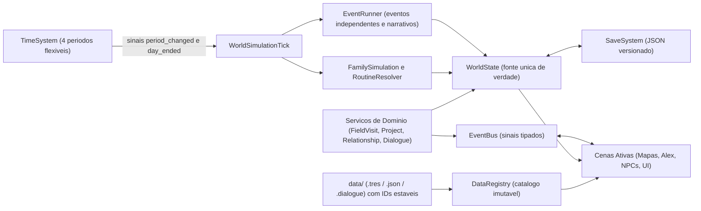

# Guia Técnico Faseado — Vertical Slice (Projeto ACS)

**Projeto:** ACS — Comunidade do Trabalho (`danzsx/comunidadedatrabalho`)  
**Repositório GitHub:** `https://github.com/danzsx/comunidadedatrabalho`  
**Diretório Local de Trabalho:** `c:\Users\nathu\OneDrive\Documentos\Vida de Trabalho`  
**Documentos Base:** [Explanation.md](./Explanation.md) e [GDD.md](./GDD.md)  
**Referências Visuais:** pasta `Inspirações visuais/` (14 imagens de referência)  
**Engine & Linguagem:** Godot 4.4.x Standard + GDScript estritamente tipado  

---

## 1. Visão Executiva & Decisões Arquiteturais (ADRs)

Este guia traduz a visão narrativa de [Explanation.md](./Explanation.md), a especificação de domínio de [GDD.md](./GDD.md) e as 14 referências visuais em um plano de engenharia enxuto, incremental e testável para entregar a **Vertical Slice (Semana 1 — 7 dias jogáveis)** sem gerar dívida técnica nem travar a produção em arte ou abstrações prematuras.

### 1.1 Registro de Decisões Arquiteturais (ADRs)

| ID | Decisão | Escolha Adotada | Justificativa de Sustentabilidade |
| :--- | :--- | :--- | :--- |
| **ADR-01** | **Engine e Linguagem** | **Godot 4.4.x Standard (GDScript estritamente tipado)** | Traz `TileMapLayer` maduro, dicionários tipados (`Dictionary[StringName, Variant]`), rastreio robusto de `.uid` e zero overhead de build `.NET`/C#. |
| **ADR-02** | **Escopo do Núcleo Global** | **Máximo de 6 Autoloads** (`EventBus`, `DataRegistry`, `WorldState`, `TimeSystem`, `SceneRouter`, `SaveSystem`) | Evita os ~40 gerenciadores acoplados do GDD inicial na pré-produção; serviços de domínio vivem como scripts/recursos puros sob demanda. |
| **ADR-03** | **Sistema de Diálogos** | **Dialogue Manager v3 (MIT, Nathan Hoad)** encapsulado atrás de uma fachada **`DialogueService`** | Texto em `.dialogue` produz diffs limpos no Git, suporta expressões contra `WorldState`, escolhas condicionais e tradução futura, mantendo regras de negócio fora do addon. |
| **ADR-04** | **Estratégia Visual** | **Arquitetura modular estilo *Stardew* + atmosfera via luz/shader estilo *Eastward* + Greybox-First** | Desenhar cada mapa como ilustração única (Eastward puro) inviabiliza a cidade. Tiles `16×16` modulares + `CanvasModulate` + `PointLight2D` entregam clima acolhedor/melancólico com custo sustentável. |
| **ADR-05** | **Persistência desde o Início** | **Save/Load versionado (`schema_version`) construído incrementalmente a partir do M0/M2** | Adiar salvamento para a última fase (Fase 7 do GDD) força reescrita de sistemas. Cada novo estado nasce já serializável e testado em round-trip. |
| **ADR-06** | **Simulação Baseada em Eventos** | **Avaliação discreta em mudança de período/dia (`WorldSimulationTick`), zero simulação por frame fora de cena** | Apenas a cena ativa instancia nós visuais de NPCs; o resto da cidade evolui por estado simbólico e regras declarativas. |
| **ADR-07** | **Repositório no OneDrive** | **Manter pasta local em `OneDrive\Documentos\Vida de Trabalho` com Protocolo de Segurança Git + Godot** | Respeita a preferência operacional do projeto mantendo regras rígidas de `.gitignore`, `.gdignore` e sincronização para evitar corrupção de `.git/index` e `.godot/`. |
| **ADR-08** | **Testes & CI** | **GUT (Godot Unit Test) + GitHub Actions `godot --headless` desde o Marco 0** | Garante integridade referencial de IDs, simulação de 7 dias sem crashes e consistência de Save/Load a cada push na `main`. |

### 1.2 Tradução dos 10 Princípios Inegociáveis do GDD em Regras de Engenharia

| Princípio do GDD (Seção 15) | Regra Concreta no Código |
| :--- | :--- |
| **1. Sistemas independentes e reutilizáveis** | Comunicação via `EventBus` (sinais tipados) ou injeção explícita; nenhuma cena de mapa importa UI diretamente e UI nunca altera dados sem passar por um Service. |
| **2. Conteúdo separado da lógica** | Personagens, famílias, rotinas, eventos, itens e projetos residem em `data/` (`.tres`, `.json`, `.dialogue`). Nenhum ID ou fala é hardcoded em controllers. |
| **3. Estado do mundo persistente** | Toda mutação de gameplay grava em `WorldState` (única fonte de verdade); cenas são apenas projeções visuais desse estado. |
| **4. Simulação baseada em eventos** | Proibido usar `_process` ou `_physics_process` para lógica de rotina/família/calendário; atualizações globais ocorrem apenas nos sinais `period_changed` e `day_ended`. |
| **5. IDs estáveis** | Todas as entidades usam `StringName` determinístico com prefixo (`&"npc_hortencia"`, `&"fam_silva"`, `&"loc_ubs"`, `&"item_mudas"`, `&"proj_jardim_rosa"`). Proibido depender de `NodePath` ou ordem na árvore de cenas. |
| **6. Nenhuma mecânica sem justificativa** | Todo projeto/crafting nasce de uma relação ou demanda comunitária (`unlock_conditions` referenciando vínculo/fato narrativo), jamais como receita solta de grinding. |
| **7. Progressão não baseada só em volume** | A evolução profissional de Alex mede **escuta, observação, vínculo, registros coerentes e articulação na UBS**, não contagem bruta de visitas. |
| **8. O mundo vive sem Alex** | `WorldSimulationTick` processa eventos agendados ou condicionais mesmo que o jogador não visite o bairro ou ignore uma situação. |
| **9. Narrativa reativa sem explosão de árvores** | Diálogos e eventos consultam fatos (`WorldState.facts`) e eixos de relação (`ConditionEvaluator`) em vez de ramificações duplicadas por combinação. |
| **10. Protótipo testável antes da expansão** | Todos os marcos M1–M5 funcionam em Greybox jogável com testes GUT verdes antes do passe visual e de conteúdo completo no M6. |

### 1.3 Protocolo de Segurança: OneDrive + Git + Godot

Como o repositório local permanecerá dentro da pasta sincronizada pelo OneDrive (`c:\Users\nathu\OneDrive\Documentos\Vida de Trabalho`), o maior risco operacional é conflito de trava de arquivos entre a sincronização na nuvem, o cache binário do Godot (`.godot/`) e o índice do Git (`.git/index`). Seguir estas 5 regras elimina 99% desses problemas:

1. **Nunca versionar caches locais da engine:** `.gitignore` deve bloquear obrigatoriamente `.godot/` (onde ficam caches binários e `.godot/imported/`), `.mono/`, `build/`, `export/`, `*.tmp` e arquivos de escritório temporários (`~$*`). Já os metadados `.import` ao lado dos arquivos em `assets/` devem permanecer versionados para preservar filtros `Nearest` e presets de importação entre máquinas e no CI.
2. **Fechar o editor Godot antes de operações Git pesadas:** nunca rodar `git checkout`, `git rebase`, `git merge` ou `git pull` com o projeto aberto no Godot, evitando arquivos bloqueados ou regravação simultânea de `.uid` pelo OneDrive.
3. **Pausar sincronização do OneDrive em lotes grandes de assets (opcional recomendado):** ao importar pacotes de sprites ou rodar builds pesados, pausar o OneDrive por 2h previne arquivos duplicados com sufixo de nome de máquina (`-DESKTOP-...`).
4. **Isolar documentação e arquivos-fonte fora da varredura do Godot:** colocar `.gdignore` dentro de `docs/` e `art_source/` impede que o Godot tente importar as 14 referências visuais (`.jpg`) ou arquivos `.aseprite` para dentro do pacote exportado.
5. **Política de binários no Git:** sprites `16×16`, tilesets PNG leves e fontes ficam em Git padrão (baixo volume, sem estourar cota gratuita de banda de 1 GB do Git LFS). Reservar **Git LFS** exclusivamente se entrarem trilhas `.wav`/`.ogg` longas ou arquivos fonte acima de 1 MB.

---

## 2. Direção Visual & Especificação Técnica de Arte

### 2.1 Parâmetros Técnicos de Viewport, Grid e Câmera

- **Resolução base (Viewport):** `480 × 270` px (proporção 16:9; escala inteira exata `4×` para `1920×1080` e `2×` para `960×540` / `3×` aproximado).
- **Stretch Mode:** `canvas_items` (ou `viewport` com `scale_mode = integer` em builds pixel-perfect; validar leitura de fontes da UI em `canvas_items` com UI em camada de resolução separada caso use fonte pixel nítida).
- **Filtro padrão de texturas:** `Nearest` (`TEXTURE_FILTER_NEAREST`), `snap_2d_transforms_to_pixel = true`, `snap_2d_vertices_to_pixel = true`.
- **Grid lógico do mundo:** `16 × 16` px por tile.
- **Proporção de personagens:** base `16 × 24` px ou `16 × 32` px (caixa de colisão nos pés: `10 × 6` px para permitir passagem fluida por portas e móveis sem enroscar).
- **Câmera Top-Down:** `Camera2D` acoplada ao jogador com suavização leve (`position_smoothing_enabled = true`, `position_smoothing_speed = 8.0`) e limites por mapa (`limit_left/top/right/bottom` definidos por `Marker2D` ou `Rect2` da cena).

### 2.2 Pilha Padrão de `TileMapLayer` (Mapas Exteriores e Interiores)

Todo mapa deve seguir exatamente a mesma ordem de camadas para que `Y-Sort`, colisões, iluminação e mudanças visuais de projeto funcionem de forma previsível:

| Ordem | Nome do Nó (`TileMapLayer` / `Node2D`) | `z_index` | `y_sort_enabled` | Função |
| :--- | :--- | :---: | :---: | :--- |
| 1 | `GroundLayer` (`TileMapLayer`) | `0` | `false` | Grama, terra, piso de madeira/cerâmica, água base. |
| 2 | `PathsDecalLayer` (`TileMapLayer`) | `1` | `false` | Calçadas brasileiras, paralelepípedo, trilhas de terra, tapetes internos, sombras no chão. |
| 3 | `WallsCollisionLayer` (`TileMapLayer`) | `2` | `true` | Paredes externas/internas, cercas, muretas, balcões com colisão. |
| 4 | `EntitiesYSort` (`Node2D`) | `3` | `true` | Contém `Alex`, `NPCs`, `PropsYSort` (`TileMapLayer`), objetos interativos e pistas de visita domiciliar. |
| 5 | `WorldPatchesRoot` (`Node2D`) | `3` | `true` | Camadas de estado visual gerenciadas pelo `WorldPatcher` (ex.: canteiro abandonado → reformado). |
| 6 | `CanopyOverlayLayer` (`TileMapLayer`) | `10` | `false` | Copas de árvores/ipês, beirais de telhado, postes altos que cobrem o jogador ao passar atrás. |
| 7 | `LightingRoot` (`Node2D`) | `20` | `false` | `CanvasModulate` global da cena + `PointLight2D` em postes, janelas e lâmpadas de interior. |

### 2.3 Sistema de Atmosfera & Iluminação (4 Períodos + Estações)

Em vez de redesenhar tiles para cada hora do dia, o `EnvironmentController` aplica presets de cor ao `CanvasModulate` e controla a intensidade das `PointLight2D` associadas ao grupo `"night_lights"`:

| Período | Cor Alvo (`CanvasModulate`) | Luzes Pontuais (`PointLight2D`) | Sensação Visual |
| :--- | :--- | :--- | :--- |
| **Manhã** | `#FFFDF5` (neutro quente suave) | Desligadas (`energy = 0.0`) | Claridade cotidiana, ruas acordando, leitura máxima de detalhes. |
| **Tarde** | `#FFD7B3` (âmbar dourado leve) | Desligadas / suaves no fim | Fim de tarde brasileiro de interior, acolhedor e nostálgico. |
| **Noite** | `#4E6294` (azul profundo legível) | Ligadas (`energy = 0.9`, halo quente `#FFB86C`) | Contrastes quentes nas janelas, praça com postes acesos, atmosfera intimista. |
| **Madrugada** | `#2B3459` (índigo frio melancólico) | Apenas pontos essenciais (`energy = 0.7`) | Silêncio, mistério sutil, preparação para sonhos/eventos especiais. |

### 2.4 Mapeamento das 14 Imagens de Referência (`Inspirações visuais/`)

| Arquivo de Referência | Aspecto Visual Absorvido para o ACS | Tradução Técnica Sustentável no Godot 4 |
| :--- | :--- | :--- |
| `cidade.jpg` | Leitura clara de bairro em top-down 3/4, caminhos orgânicos de terra/pedra ligando praça, comércio e casas. | Grid `16×16` em `TileMapLayer`, transição limpa entre asfalto/calçada/terra e pontos focais (UBS, Praça, Casas). |
| `ideia_farm.jpg` | Indicadores contextuais sobre objetos no mundo (ícone de carta/balão sobre caixa de correio) e degraus/varandas legíveis. | `InteractionPrompt` flutuante sobre objetos interativos/NPCs e desníveis simples com `TileMapLayer`. |
| `mapa 1.jpg` | Densidade de rua viva, barracas/feiras comunitárias, texturas desgastadas e cor atmosférica coesa. | Composição de props em `EntitiesYSort` + shader leve de paleta/vinheta sutil para unificar tiles simples. |
| `mapa 2.jpg` | Contraste de iluminação quente de fim de tarde com sombras longas e calçada com múltiplos moradores em rotina. | `CanvasModulate` quente no período `Tarde` + NPCs posicionados por `RoutineResolver` na praça/comércio. |
| `mapa 3.jpg` | Cena noturna azulada com cordão de luzes quentes refletindo e destacando pontos de encontro. | `PointLight2D` com textura radial suave em postes da praça e varandas durante `Noite` e `Madrugada`. |
| `mapa 4.jpg` | Balão de fala no mundo junto ao personagem + card discreto de relação no canto superior direito. | `WorldSpeechBubble` opcional para reações curtas sem travar movimento + indicador discreto em diálogo/perfil. |
| `casa.jpg` | Quarto/casa acolhedor, luz quente de janela/abajur, tapetes e plantas que expressam a personalidade do morador. | Cenas pequenas de interior (`16×12` a `22×16` tiles) onde móveis funcionam como pistas narrativas inspecionáveis. |
| `organizacao.jpg` | Interior de depósito/almoxarifado organizado com estantes, caixas e bancadas cheias de contexto visual. | Modelo para a sala de materiais/arquivo da UBS e áreas de trabalho dos moradores sem poluir a UI. |
| `preparacao_pessoaç.jpg` | Cozinha/casa simples com sinais claros de rotina cotidiana (louça, geladeira, desgaste, intimidade). | Modelo visual para a Casa de Alex (cozinhar/estudar/descansar) e residências que mudam de estado conforme a narrativa. |
| `ideia_farm2.jpg` | Cultivo em pequena escala próximo à residência, cerca de madeira e ferramenta ao lado do canteiro. | Canteiros pontuais (não fazenda gigante), integrados à vida do bairro ou projeto de um morador. |
| `jardim_comunitario.jpg` | Canteiros elevados em área urbana/quintal, regador, foco em cuidado localizado e observação do entorno. | Formato exato do projeto pessoal/comunitário na Vertical Slice (canteiros discretos alterados via `WorldPatcher`). |
| `recuperacao_comunitaria.jpg` | Prédio comunitário restaurado e moradores reunidos celebrando a transformação do espaço público. | Cena/estado pós-conclusão de projeto (`WorldPatcher` muda o visual da praça/canteiro e dispara evento de celebração). |
| `craft.jpg` | Painel de criação/projeto com lista limpa, itens necessários no formato `tem/precisa` e etapas visuais objetivas. | `ProjectUI` inspirada nessa clareza de leitura (com paleta quente/papel em vez de estética medieval escura). |
| `passagem do tempo.jpg` | Percepção imediata da mudança temporal/sazonal no mesmo cenário (vegetação, paleta de céu e atmosfera). | `EnvironmentController` modulando cor por período e hooks no `WorldState` preparados para variações sazonais futuras. |

### 2.5 Política Greybox-First (Obrigatória nos Marcos M1–M5)

Para impedir que a produção de arte trave o gameplay:
- **M1 a M5 usam apenas placeholders funcionais:** tileset programático `16×16` de alto contraste (grama, terra, calçada, piso interno, parede, porta, água, canteiro) e sprites simples com cor/acessório distinto por personagem (Alex, Hortência e os 7 moradores).
- **Validação antes da arte final:** escala da câmera, largura de corredores/portas, visibilidade noturna, ritmo da caminhada e leitura de pistas devem estar 100% aprovados em Greybox.
- **Primeiro passe de pixel art brasileira (M6):** só após o loop completo da Vertical Slice passar em todos os testes é feito o upgrade visual de bairro, UBS, Casa de Alex e retratos.

---

## 3. Arquitetura Sustentável (Godot 4 + GDScript Tipado)

### 3.1 Diagrama de Fluxo de Dados e Dependências



### 3.2 Os 6 Autoloads do Núcleo (Específico e Fechado)

Nenhum outro script deve ser adicionado como Autoload na Vertical Slice além destes seis:

1. **`EventBus`** (`scripts/core/event_bus.gd`)
   - Barramento puro de sinais tipados (não guarda estado).
   - Sinais principais:
     - `period_changed(new_day: int, new_period: int)`
     - `day_ended(ended_day: int)`
     - `world_fact_changed(fact_id: StringName, new_value: Variant)`
     - `relationship_changed(npc_id: StringName, axis: StringName, new_value: int)`
     - `household_record_updated(family_id: StringName)`
     - `project_stage_changed(project_id: StringName, new_stage: int)`
     - `world_patch_applied(patch_id: StringName, active_stage: int)`
     - `dialogue_requested(dialogue_id: StringName, start_node: String, context: Dictionary)`
     - `dialogue_finished(dialogue_id: StringName)`
     - `scene_change_requested(location_id: StringName, spawn_id: StringName)`
     - `notification_requested(text: String, category: StringName)`

2. **`DataRegistry`** (`scripts/core/data_registry.gd`)
   - Carrega na inicialização todas as definições estáticas de `data/` para dicionários indexados por `StringName` (`characters`, `families`, `locations`, `routines`, `events`, `items`, `projects`).
   - Imutável em runtime: nenhuma mecânica altera um `Resource` do `DataRegistry` durante o jogo.
   - Expõe `validate_integrity() -> Array[String]` para uso nos testes e em `OS.is_debug_build()`.

3. **`WorldState`** (`scripts/core/world_state.gd`)
   - **Fonte única de verdade** de todo o estado mutável da partida:
     - `schema_version: int = 1`
     - `day: int`, `week: int`, `month: int`, `season: StringName`, `period: int` (`0=Manhã, 1=Tarde, 2=Noite, 3=Madrugada`)
     - `current_location_id: StringName`, `current_spawn_id: StringName`, `player_position: Vector2`
     - `facts: Dictionary[StringName, Variant]` (flags e contadores narrativos, ex.: `&"ubs_briefed_day1": true`, `&"alex_study_points": 2`)
     - `relationships: Dictionary[StringName, Dictionary]` (para cada `npc_id`: `{"trust": int, "affinity": int, "familiarity": int, "cooperation": int}`)
     - `npc_states: Dictionary[StringName, Dictionary]` (`location_id`, `alive`, `residence_id`, `mood_tag`, `custom_flags`)
     - `family_states: Dictionary[StringName, Dictionary]` (`members: Array[StringName]`, `residence_id`, `active_situations: Array[StringName]`, `resolved_situations: Array[StringName]`, `history: Array[Dictionary]`)
     - `household_records: Dictionary[StringName, Dictionary]` (anotações do Caderno de Campo do Alex por `family_id`: observações descobertas, status de encaminhamento, data da última visita)
     - `field_visits: Dictionary[StringName, Dictionary]` (etapa atual de visitas em andamento)
     - `inventory: Dictionary[StringName, int]` (`item_id -> quantidade`)
     - `projects: Dictionary[StringName, Dictionary]` (`project_id -> {"unlocked": bool, "stage": int, "contributed": Dictionary, "completed": bool}`)
     - `world_patches: Dictionary[StringName, int]` (`patch_id -> stage_visual_atual`)
     - `completed_events: Array[StringName]`, `pending_events: Array[Dictionary]`
     - `career_trajectory: Dictionary[StringName, int]` (variáveis persistentes sem julgamento moral: `acs_engagement`, `academic_focus`, `community_ties`, `self_reflection`)
     - `unlocked_regions: Array[StringName]`
   - Expõe `to_dict() -> Dictionary` e `from_dict(data: Dictionary) -> void`.

4. **`TimeSystem`** (`scripts/core/time_system.gd`)
   - Controla os 4 períodos flexíveis (**Manhã, Tarde, Noite, Madrugada**) sem relógio punitivo correndo em segundos reais durante diálogos/exploração livre.
   - O período avança quando:
     - Uma ação de bloco é confirmada (ex.: concluir visita domiciliar completa, estudar em casa, trabalhar em etapa de projeto, descansar).
     - Ou o jogador opta explicitamente por descansar/passar período (na Casa de Alex ou ponto de descanso).
   - Quando `period` passa de `Madrugada (3)` para `Manhã (0)` do próximo dia (ou ao dormir), dispara `WorldSimulationTick.run_day_transition()` antes de liberar o novo dia ao jogador.

5. **`SceneRouter`** (`scripts/core/scene_router.gd`)
   - Carrega cenas de mapas/interiores registradas no `DataRegistry` (`LocationData.scene_path`), executa fade suave (`CanvasLayer` de transição), posiciona `Alex` no `Marker2D` correspondente ao `spawn_id`, atualiza o `EnvironmentController`, aplica `WorldPatcher` daquela cena e instancia **apenas os NPCs que o `RoutineResolver` indicar estarem presentes naquele `location_id` e período**.

6. **`SaveSystem`** (`scripts/core/save_system.gd`)
   - Persiste e restaura `WorldState` em `user://saves/slot_<n>.json` e `user://saves/autosave.json`.
   - Inclui cabeçalho com `schema_version`, `timestamp_iso`, `day`, `period`, `current_location_id` e pipeline `migrate_save_data(raw: Dictionary) -> Dictionary` para que saves antigos nunca quebrem entre marcos.

### 3.3 Pipeline Determinístico de Simulação (`WorldSimulationTick`)

Executado **somente** em transições de período e fim de dia (nunca em `_process`):

1. **Jogador encerra o período ou o dia** (`TimeSystem.advance_period()` / `sleep()`).
2. **`TimeSystem`** atualiza `day`/`week`/`period` no `WorldState`.
3. **`WorldSimulationTick.process_tick(is_day_end: bool)`** executa em ordem estrita:
   1. **`EventRunner.evaluate_events()`:** verifica `WorldEventData` cujas `activation_conditions` foram satisfeitas (inclusive eventos agendados por dia/período que independem da presença de Alex) e aplica seus `effects` no `WorldState`.
   2. **`FamilySimulation.process_day_tick()` (em virada de dia):** avalia transições familiares agendadas/condicionais (evolução de situações não atendidas, mudanças de rotina ou composição familiar).
   3. **`RelationshipService.apply_pending_adjustments()`:** atualiza dimensões de relação decorrentes de eventos do dia.
   4. **`RoutineResolver.recompute_npc_locations()`:** calcula onde cada NPC está no novo período e salva em `WorldState.npc_states[id].location_id`.
4. **Atualização da cena ativa:** se o jogador permanece no mesmo mapa ao avançar período, os NPCs entram/saem conforme o novo `location_id` e o `EnvironmentController` interpola a luz.
5. **Autosave diário:** na virada do dia, `SaveSystem.save_autosave()` grava o novo estado persistido.

### 3.4 Serviços de Domínio (Scripts Modulares sob `scripts/`)

- **`ConditionEvaluator` (`scripts/systems/condition_evaluator.gd`):** avalia regras declarativas contra `WorldState` (ex.: `fact_equals`, `fact_gte`, `rel_gte`, `day_gte`, `period_in`, `event_completed`, `project_stage`, `item_count_gte`). Usado igualmente por diálogos, eventos, rotinas e projetos.
- **`EffectApplier` (`scripts/systems/effect_applier.gd`):** executa efeitos declarativos (`set_fact`, `inc_fact`, `add_relationship`, `give_item`, `consume_item`, `unlock_project`, `add_notebook_clue`, `set_world_patch`, `inc_career_axis`).
- **`RelationshipService` (`scripts/characters/relationship_service.gd`):** gerencia os **4 eixos independentes** exigidos no GDD:
  - `trust` (Confiança — abertura para compartilhar problemas sensíveis da casa)
  - `affinity` (Afinidade — empatia pessoal com Alex)
  - `familiarity` (Familiaridade — convivência cotidiana no bairro)
  - `cooperation` (Cooperação — disposição para agir em conjunto na comunidade/projetos)
- **`FieldVisitService` (`scripts/professional/field_visit_service.gd`):** implementa o fluxo de visita do ACS em etapas reais da profissão (sem medicalização/diagnóstico clínico):
  1. **Demanda / Briefing** (Hortência ou Quadro da UBS)
  2. **Deslocamento até a residência**
  3. **Observação ambiental** (inspecionar 2–3 pistas visuais na casa, registradas como fatos)
  4. **Escuta / Conversa** (opções reativas ao nível de `trust`/`familiarity` e pistas já observadas)
  5. **Registro no Caderno de Campo** (`HouseholdRecordService`)
  6. **Articulação / Encaminhamento na UBS** (decisão entre opções com consequências reais nos dias seguintes)
- **`HouseholdRecordService` (`scripts/professional/household_record_service.gd`):** mantém a ficha de cada família e valida coerência dos registros para o `NotebookUI`.
- **`ProjectService` (`scripts/systems/project_service.gd`) & `WorldPatcher` (`scripts/world/world_patcher.gd`):** controla desbloqueio narrativo de projetos, entrega contextualizada de recursos/conhecimentos por etapa e troca automática das camadas visuais `WorldPatchesRoot` no mapa.
- **`DialogueService` (`scripts/systems/dialogue_service.gd`):** única ponte com o addon **Dialogue Manager v3**; injeta acesso controlado a `WorldState`, `ConditionEvaluator`, `EffectApplier` e `RelationshipService`, exibe retratos/opções no `DialogueUI` e bloqueia movimento durante conversas modais.

### 3.5 Esquemas de `Resource` Tipados (`scripts/data/`)

Todos os arquivos em `data/` instanciam classes GDScript herdando de `Resource`:

- **`CharacterData`:** `id: StringName`, `display_name: String`, `age: int`, `occupation: String`, `family_id: StringName`, `residence_id: StringName`, `personality_tags: Array[StringName]`, `interests: Array[StringName]`, `knowledge_tags: Array[StringName]`, `portrait_set: Dictionary`, `sprite_frames: SpriteFrames`, `dialogue_id: StringName`.
- **`FamilyData`:** `id: StringName`, `family_name: String`, `residence_id: StringName`, `initial_members: Array[StringName]`, `summary: String`, `initial_conditions: Array[StringName]`, `notes_seed: String`.
- **`RoutineEntry`:** `npc_id: StringName`, `day_filter: Array[int]` (vazio = todos os dias), `period: int`, `location_id: StringName`, `marker_name: StringName`, `priority: int`, `conditions: Array[Dictionary]`, `ambient_line: String`.
- **`WorldEventData`:** `id: StringName`, `title: String`, `can_happen_offscreen: bool`, `once: bool`, `min_day: int`, `target_period: int`, `conditions: Array[Dictionary]`, `effects: Array[Dictionary]`, `notification_hint: String`.
- **`ProjectData`:** `id: StringName`, `title: String`, `description: String`, `involved_npcs: Array[StringName]`, `unlock_conditions: Array[Dictionary]`, `stages: Array[Dictionary]` (`label`, `required_items`, `required_facts`, `completion_effects`), `world_patch_id: StringName`.
- **`ItemData`:** `id: StringName`, `display_name: String`, `description: String`, `category: StringName` (`&"key_doc"`, `&"material"`, `&"garden"`, `&"personal"`), `icon: Texture2D`, `stackable: bool`.
- **`LocationData`:** `id: StringName`, `display_name: String`, `scene_path: String`, `region_id: StringName`, `is_interior: bool`, `default_period_lighting: bool`.
- **`HouseholdRecord`:** modelo tipado (`Resource` / `RefCounted` serializável em `WorldState.household_records`) para o Caderno de Campo por família: `family_id: StringName`, `last_visit_day: int`, `discovered_clues: Array[StringName]`, `observations: Array[String]`, `referral_status: StringName` (`&"none"`, `&"pending_ubs"`, `&"referred_support"`, `&"closed_strained"`), `follow_up_day: int`.

---

## 4. Estrutura do Repositório, Fluxo Git & Qualidade

### 4.1 Estrutura Alvo de Diretórios

```text
Vida de Trabalho/                     # Raiz do repositório git (danzsx/comunidadedatrabalho)
├── .github/
│   └── workflows/
│       └── ci.yml                    # Valida GUT + integridade de IDs em godot --headless
├── .gitignore                        # Ignora .godot/, builds/, *.tmp, ~$*, saves locais
├── .gitattributes                    # Line endings LF p/ .gd/.dialogue/.md/.json; CRLF/auto seguro
├── README.md                         # Setup do Godot 4.4, comandos de teste e convenções
├── project.godot                     # Configuração 480x270, Nearest, warnings estritos, Autoloads
├── addons/
│   ├── dialogue_manager/             # Addon Dialogue Manager v3 (MIT)
│   └── gut/                          # Addon Godot Unit Test (MIT)
├── docs/
│   ├── .gdignore                     # Impede importação de documentação e JPGs no pacote do jogo
│   ├── GDD.md                        # Migrado de Contexto inicial/GDD.md
│   ├── Explanation.md                # Migrado de Contexto inicial/Explanation.md
│   ├── GUIA_TECNICO_VERTICAL_SLICE.md
│   └── visual_references/            # Migrado de Inspirações visuais/ (14 imagens)
├── art_source/
│   └── .gdignore                     # Arquivos .aseprite, rascunhos de mapa e paletas fonte
├── assets/
│   ├── characters/
│   ├── environments/
│   ├── tilesets/
│   ├── objects/
│   ├── ui/
│   ├── audio/
│   └── fonts/
├── shaders/
│   ├── lighting_atmosphere.gdshader
│   └── water_ripple.gdshader
├── scenes/
│   ├── boot/                         # Main.tscn (ponto de entrada único)
│   ├── player/                       # Alex.tscn
│   ├── npcs/                         # NPCBase.tscn
│   ├── components/                   # Interactable.tscn, ScenePortal.tscn, ClueObject.tscn
│   ├── maps/                         # BairroPraca.tscn (externo da Vertical Slice)
│   ├── interiors/                    # CasaAlex.tscn, UBS.tscn, CasaFamiliaA/B/C.tscn
│   └── ui/                           # HUD.tscn, DialogueUI.tscn, NotebookUI.tscn, ProjectUI.tscn, PauseSaveUI.tscn
├── scripts/
│   ├── core/                         # EventBus, DataRegistry, WorldState, TimeSystem, SceneRouter, SaveSystem
│   ├── data/                         # Definições class_name de Resources tipados
│   ├── world/                        # EnvironmentController, WorldPatcher, ScenePortal, WorldSimulationTick
│   ├── characters/                   # PlayerController, NPCController, RoutineResolver, RelationshipService, FamilySimulation
│   ├── systems/                      # InteractionSystem, ConditionEvaluator, EffectApplier, DialogueService, InventorySystem, ProjectService
│   ├── professional/                 # FieldVisitService, HouseholdRecordService
│   ├── player_life/                  # HomeActivityService (estudo/descanso/preparo)
│   └── ui/                           # Controllers de HUD, Caderno, Diálogo e Projetos
├── data/
│   ├── characters/                   # .tres (Alex, Hortência + 7 moradores)
│   ├── families/                     # .tres (3 famílias da Vertical Slice)
│   ├── locations/                    # .tres (6 localizações)
│   ├── routines/                     # .tres (rotinas por período/dia)
│   ├── events/                       # .tres (eventos independentes e narrativos)
│   ├── items/                        # .tres (itens/documentos/materiais)
│   ├── projects/                     # .tres (projeto pessoal contextualizado)
│   └── dialogues/                    # .dialogue (falas e escolhas)
└── tests/
    ├── unit/                         # Testes rápidos de serviços e avaliadores
    └── integration/                  # Integridade do DataRegistry, simulação 7 dias, Save/Load round-trip
```

> **Nota sobre migração de pastas:** no Marco 0, o conteúdo atual de `Contexto inicial/` e `Inspirações visuais/` será organizado dentro de `docs/` (com `.gdignore`) para manter a raiz do projeto Godot limpa e padronizada.

### 4.2 Política de Branches, Commits e Qualidade de Código

- **Branches:** `main` sempre compilável, jogável e com CI verde. Cada marco ou sub-tarefa trabalha em branch curta (`feat/m0-foundation`, `feat/m1-world-maps`, etc.) e entra na `main` após passar nos testes.
- **Conventional Commits em PT ou EN consistente:** `feat(m3): add RoutineResolver and offscreen day simulation`, `test(save): add full WorldState round-trip test`, `docs: add technical vertical slice guide`.
- **Avisos de tipagem como regra no `project.godot`:**
  - `debug/gdscript/warnings/untyped_declaration = 2` (Erro)
  - `debug/gdscript/warnings/inferred_declaration = 1` (Aviso)
  - `debug/gdscript/warnings/unused_signal = 1`
  - `debug/gdscript/warnings/return_value_discarded = 1`

### 4.3 As 4 Suítes Obrigatórias de Teste (GUT + CI Headless)

1. **`test_data_integrity.gd`:** percorre todos os arquivos em `data/` e falha se qualquer rotina, evento, projeto ou família referenciar um `npc_id`, `family_id`, `location_id` ou `item_id` inexistente no `DataRegistry`.
2. **`test_simulation_7_days.gd`:** inicializa um `WorldState` limpo e avança os `28` períodos (`7 dias × 4 períodos`) em modo headless, verificando se rotinas atualizam sem nulos, se o evento independente dispara e se nenhum erro de script ocorre.
3. **`test_domain_rules.gd`:** valida cálculo independente dos 4 eixos de relação (`trust`, `affinity`, `familiarity`, `cooperation`), etapas da visita domiciliar no `FieldVisitService` e requisitos de projeto no `ProjectService`.
4. **`test_save_roundtrip.gd`:** cria um `WorldState` complexo (Dia 5, Tarde, relações alteradas, pistas no caderno, projeto em andamento, patch visual ativo, inventário populado), salva em caminho temporário de teste, reseta o estado e recarrega comparando 100% dos campos chave.

---

## 5. Recorte de Conteúdo da Vertical Slice (Semana 1 — 7 Dias)

Conforme a Seção 13 do [GDD.md](./GDD.md), a Vertical Slice deve entregar um mundo pequeno, vivo e interconectado, com **6 cenas navegáveis**, **Hortência + 7 moradores (3 famílias)** e **7 dias jogáveis**.

### 5.1 Mapa Espacial da Vertical Slice (6 Cenas)

| ID do Local (`StringName`) | Cena | Papel na Vertical Slice |
| :--- | :--- | :--- |
| `&"loc_bairro_praca"` | `BairroPraca.tscn` | Mapa externo principal ligando a Casa de Alex, a UBS, a Praça central (com um canteiro comunitário degradado) e as fachadas das 3 residências. |
| `&"loc_casa_alex"` | `CasaAlex.tscn` | Base pessoal de Alex: dormir/encerrar o dia, estudar apostilas da faculdade, guardar notas, refletir/preparar rotina. |
| `&"loc_ubs"` | `UBS.tscn` | Ponto de partida do trabalho: recepção, sala de reuniões/arquivo e mesa de Hortência (briefing de visitas, entrega e discussão de encaminhamentos). |
| `&"loc_casa_fam_a"` | `CasaFamiliaA.tscn` | Residência de foco da **Visita Domiciliar Completa + Situação Narrativa com Consequências** (contém 3 pistas observáveis no ambiente). |
| `&"loc_casa_fam_b"` | `CasaFamiliaB.tscn` | Residência de foco do **Projeto Pessoal Contextualizado** (oficina simples ou quintal com jardim/horta de cuidado doméstico). |
| `&"loc_casa_fam_c"` | `CasaFamiliaC.tscn` | Residência de foco do **Evento Independente de Alex** (casa onde uma mudança acontece na semana independentemente da intervenção do jogador). |

### 5.2 Elenco Funcional (Hortência + 7 Moradores em 3 Famílias)

A estrutura abaixo define o papel sistêmico de cada personagem/família para validar todos os pilares do jogo (os nomes próprios definitivos podem ser ajustados na escrita dos `.dialogue`, mantendo os IDs estáveis):

| Entidade / ID | Composição | Papel Sistêmico na Vertical Slice |
| :--- | :--- | :--- |
| **`&"npc_hortencia"`** (UBS) | Mentora experiente de ACS | Conduz o acolhimento no Dia 1, passa a primeira demanda estruturada, orienta limites éticos do papel de ACS (não diagnosticar, saber ouvir e articular) e reage às decisões de encaminhamento de Alex. |
| **`&"fam_a"`** — **Família Foco da Visita & Consequência** (3 moradores: ex.: idoso/cuidadora/neto) | `&"npc_a_1"`, `&"npc_a_2"`, `&"npc_a_3"` | Permite executar a **visita domiciliar completa** (observação do ambiente + escuta sensível a `trust` + registro no Caderno + decisão de encaminhamento na UBS). A escolha entre abordar com paciência ou pressa/rigidez muda permanentemente a confiança da família e o desfecho no Dia 5–6. |
| **`&"fam_b"`** — **Família Foco do Vínculo & Projeto** (2 moradores: ex.: moradora jardineira/artesã e filho ou mecânico vizinho) | `&"npc_b_1"`, `&"npc_b_2"` | Inicialmente reservada; ao construir `familiarity` e `affinity` (via conversas cotidianas na praça e cuidado na visita), ensina conhecimento prático e desbloqueia o **Projeto Pessoal Contextualizado** (ex.: recuperar o canteiro da praça / consertar bicicleta com peças simples), alterando o mapa via `WorldPatcher`. |
| **`&"fam_c"`** — **Família Foco do Mundo Vivo Independente** (2 moradores: ex.: casal trabalhador ou jovem de mudança) | `&"npc_c_1"`, `&"npc_c_2"` | Protagoniza o **Evento Independente de Alex** (ex.: conflito de trabalho/mudança de turno ou partida temporária de um morador no Dia 4). Se Alex visitar ou observar antes, vê os sinais e dialoga sobre o processo; se não for, o evento acontece mesmo assim e o bairro comenta a mudança depois. |

### 5.3 Arco Jogável dos 7 Dias (Conectando Todas as Mecânicas)

| Dia | Foco Narrativo e Sistêmico |
| :--- | :--- |
| **Dia 1** | **Chegada e Acolhimento:** Alex acorda em `CasaAlex`, vai até `UBS`, conhece **Hortência**, recebe o **Caderno de Campo**, faz o reconhecimento do bairro e conhece os primeiros moradores na praça. |
| **Dia 2** | **Primeira Visita Completa (`&"fam_a"`):** visita guiada/orientada à `CasaFamiliaA`; o jogador observa o ambiente (3 pistas visuais), conversa, registra no Caderno de Campo e retorna à UBS para escolher como registrar/articular a situação. |
| **Dia 3** | **Rotina Própria & Vínculos:** Alex concilia retorno à `CasaFamiliaA` (ou acompanhamento), conversas livres em horários diferentes (Manhã/Tarde/Noite) e escolhe entre dedicar a Noite a estudar para a faculdade ou conversar na praça (`&"fam_b"`). |
| **Dia 4** | **O Mundo Segue Sem Você (`&"fam_c"`):** dispara o **evento independente de Alex** na `fam_c`, alterando rotinas e diálogos do bairro independentemente da presença do jogador. Consolidação de confiança com `&"fam_b"` desbloqueia o **Projeto Pessoal**. |
| **Dia 5** | **Consequências & Construção:** a abordagem tomada na `fam_a` gera consequência visível (abertura para apoio comunitário ou distanciamento). Coleta/obtenção contextualizada dos materiais do projeto da `fam_b`. |
| **Dia 6** | **Transformação no Mundo:** conclusão das etapas do projeto pessoal/comunitário; `WorldPatcher` transforma visualmente o espaço no `BairroPraca.tscn` e moradores reagem à mudança física. |
| **Dia 7** | **Fechamento da Semana & Persistência:** conversa de balanço da primeira semana com Hortência na UBS (refletindo a trajetória registrada até ali, sem impor um único destino), transição noturna/madrugada com primeiro indício atmosférico do mistério cotidiano da cidade e validação completa de Save/Load. |

---

## 6. Guia Técnico Faseado — Marcos M0 a M6

---

### Marco 0 — Fundação, Repositório & Governança

**Objetivo:** Estruturar o repositório `danzsx/comunidadedatrabalho`, configurar o projeto Godot 4.4 com tipagem estrita, instalar GUT e Dialogue Manager, criar a camada mínima de núcleo + CI headless e garantir que tudo abra e passe testes antes de criar cenas de jogo.

#### Escopo & Arquivos Criados
- `.gitignore`, `.gitattributes`, `README.md`
- `.github/workflows/ci.yml`
- `docs/.gdignore`, `art_source/.gdignore`
- Migração de `Contexto inicial/*` → `docs/` e `Inspirações visuais/*` → `docs/visual_references/`
- `project.godot` (480×270, Nearest, Pixel Snap, warnings de tipagem como erro/aviso, registro dos Autoloads iniciais)
- `addons/gut/` e `addons/dialogue_manager/`
- `scripts/core/event_bus.gd`, `scripts/core/world_state.gd`, `scripts/core/save_system.gd`
- `tests/unit/test_smoke_world_state.gd`

#### Regras Técnicas de Implementação
- Configurar `SaveSystem` v1 já no M0 serializando `schema_version`, `day`, `period` e `facts` em JSON formatado.
- Validar localmente com `godot --headless --quit` e execução da CLI do GUT antes de qualquer commit.
- Confirmar no `.gitignore` que `.godot/` nunca aparece em `git status`.

#### Testes (GUT + Manual)
- **GUT:** `test_smoke_world_state.gd` instancia `WorldState`, altera `day` e `facts`, executa `SaveSystem` para arquivo temporário e valida o round-trip.
- **Manual:** abrir o projeto no editor Godot 4.4 sem nenhum erro ou warning no painel Output; verificar na aba FileSystem que `docs/` e `art_source/` não aparecem no projeto importado.

#### Critério de Pronto (DoD)
- Push inicial na `main` de `danzsx/comunidadedatrabalho` com GitHub Actions rodando `godot --headless` e passando verde.

#### Checkpoint Git
- Branch `feat/m0-foundation` → merge em `main` com tag `v0.0.1-m0`.

#### Riscos & Armadilhas
- **OneDrive travando `.git/index` ou `.godot/`:** validar `.gitignore` antes do primeiro `git add .` e manter o editor fechado durante o commit inicial.
- **Versão do Godot diferente no CI e local:** fixar a mesma versão exata `4.4.x` no workflow do GitHub Actions e no `README.md`.

---

### Marco 1 — Mundo Explorável, Transições & Atmosfera (Greybox)

**Objetivo:** Permitir que Alex caminhe por toda a Vertical Slice (6 cenas conectadas) com colisões corretas, câmera top-down suave, `Y-Sort` e iluminação dinâmica dos 4 períodos.

#### Escopo & Arquivos Criados
- Tileset Greybox `16×16` (`assets/tilesets/greybox_world.png` + `TileSet` configurado com colisões e terreno).
- `scenes/boot/Main.tscn` (gerencia container de cena ativa e camada de fade/UI).
- `scenes/player/Alex.tscn` + `scripts/characters/player_controller.gd`.
- `scenes/components/ScenePortal.tscn` + `scripts/world/scene_portal.gd`.
- `scenes/maps/BairroPraca.tscn` + `scenes/interiors/{CasaAlex,UBS,CasaFamiliaA,CasaFamiliaB,CasaFamiliaC}.tscn`.
- `scripts/core/data_registry.gd` (carregando `LocationData`), `scripts/core/scene_router.gd`, `scripts/world/environment_controller.gd`.

#### Regras Técnicas de Implementação
- `PlayerController` usa `CharacterBody2D` com colisão reduzida nos pés (`10×6` px) e velocidade confortável de bairro (~`75–85 px/s` na resolução 480×270).
- Todos os portais entre cenas usam `location_id: StringName` + `target_spawn_id: StringName` apontando para `Marker2D` filhos de um nó `SpawnPoints` em cada cena.
- `EnvironmentController` lê o período atual e interpola o `CanvasModulate` entre os 4 presets (Manhã/Tarde/Noite/Madrugada) além de ativar luzes do grupo `"night_lights"`.
- Incluir atalho temporário de debug (`F5`/`F6` apenas em `OS.is_debug_build()`) para ciclar os 4 períodos visualmente.

#### Testes (GUT + Manual)
- **GUT:** `test_locations_integrity.gd` verifica se todo `LocationData.scene_path` existe no disco e se cada `ScenePortal` aponta para um `location_id` e `spawn_id` válidos.
- **Manual:** entrar e sair de todas as 5 portas a partir do `BairroPraca`, testar `Y-Sort` atrás de árvores/móveis e ciclar os 4 períodos verificando legibilidade noturna.

#### Critério de Pronto (DoD)
- Navegação contínua sem travamentos nas quinas de paredes, sem spawns fora de mapa e com transição de cor/luz funcionando em todas as 6 cenas.

#### Checkpoint Git
- Branch `feat/m1-explorable-world` → merge em `main` com tag `v0.1.0-m1`.

#### Riscos & Armadilhas
- **Porta com área grande demais dispara transição dupla:** usar trava de cooldown/estado `is_transitioning` no `SceneRouter` e exigir entrada intencional ou posicionamento seguro fora da `Area2D` no `SpawnPoint`.

---

### Marco 2 — Dados, Interação, Diálogos & Condições

**Objetivo:** Tornar o mundo comunicativo: catálogo de personagens e famílias em `Resource`, sistema de interação contextual e diálogos dirigidos por estado no `WorldState`.

#### Escopo & Arquivos Criados
- `scripts/data/{character_data,family_data,item_data,location_data}.gd`
- `data/characters/` (Alex, Hortência e os 7 moradores em `.tres`)
- `data/families/` (`fam_a.tres`, `fam_b.tres`, `fam_c.tres`)
- `scenes/npcs/NPCBase.tscn` + `scripts/characters/npc_controller.gd`
- `scenes/components/Interactable.tscn` + `scripts/systems/interaction_system.gd`
- `scripts/systems/condition_evaluator.gd`, `scripts/systems/effect_applier.gd`, `scripts/systems/dialogue_service.gd`
- `scenes/ui/DialogueUI.tscn` + `scripts/ui/dialogue_ui.gd`
- `data/dialogues/` (diálogos iniciais de Hortência e moradores)

#### Regras Técnicas de Implementação
- `InteractionSystem` fica acoplado a Alex (pequeno `Area2D` orientado para a direção do último movimento) e detecta o `Interactable` mais próximo com maior prioridade, exibindo um prompt visual limpo (como o indicador contextual de `ideia_farm.jpg`).
- O addon **Dialogue Manager** jamais acessa diretamente nós de mapa; ele conversa apenas com a fachada `DialogueService`, que expõe métodos seguros como `has_fact()`, `set_fact()`, `get_rel()`, `add_rel()`, `give_item()`.
- Durante um diálogo ativo, `PlayerController` entra em estado bloqueado de movimento e input de interação avança/seleciona falas sem conflito.

#### Testes (GUT + Manual)
- **GUT:** `test_condition_evaluator.gd`, `test_effect_applier.gd` e expansão do `test_data_integrity.gd` validando todas as chaves de `CharacterData` e `FamilyData`.
- **Manual:** conversar com Hortência e moradores, fazer uma escolha no diálogo que grava um fato no `WorldState`, salvar/recarregar (ou falar novamente) e comprovar que o diálogo reage ao novo fato.

#### Critério de Pronto (DoD)
- Todos os 8 NPCs da Vertical Slice possuem `CharacterData` válido, interagem no mundo e leem/gravam fatos em `WorldState` via `DialogueService`.

#### Checkpoint Git
- Branch `feat/m2-dialogue-data` → merge em `main` com tag `v0.2.0-m2`.

#### Riscos & Armadilhas
- **Lógica de missão presa dentro de arquivos `.dialogue`:** manter o `.dialogue` restrito a texto, ramificações de fala e chamadas curtas a `DialogueService`; regras complexas de visita/projeto ficam sempre em GDScript.

---

### Marco 3 — Tempo Flexível, Rotinas & Cidade Viva Independente

**Objetivo:** Fazer a cidade respirar ao longo dos 7 dias e 4 períodos, com rotinas dinâmicas de NPCs e pelo menos um evento significativo que acontece independentemente da presença de Alex.

#### Escopo & Arquivos Criados
- `scripts/core/time_system.gd`
- `scripts/data/{routine_entry,world_event_data}.gd`
- `scripts/world/world_simulation_tick.gd`
- `scripts/characters/{routine_resolver,family_simulation}.gd`
- `scripts/systems/event_runner.gd`
- `data/routines/` (rotinas básicas dos 8 NPCs pelos 4 períodos)
- `data/events/` (incluindo o **evento independente da `fam_c`** no Dia 4)
- `scenes/ui/HUD.tscn` (Dia da semana, Período atual, Nome do local/bairro)

#### Regras Técnicas de Implementação
- `RoutineResolver` escolhe para cada NPC o `RoutineEntry` de maior `priority` cujas `conditions`, `day_filter` e `period` casem com o `WorldState` atual.
- Ao carregar uma cena via `SceneRouter` (ou quando `period_changed` ocorre na cena atual), apenas os NPCs cujo `location_id` resolvido corresponde à cena aberta são instanciados/posicionados nos `Marker2D` indicados.
- O **evento independente (`evt_fam_c_independent_shift`)** possui `can_happen_offscreen = true` e `min_day = 4`. Ao disparar no `WorldSimulationTick`, altera `WorldState.facts`, muda o estado da `fam_c` e modifica a rotina/diálogo de seus membros e vizinhos — mesmo que Alex nunca tenha entrado na `CasaFamiliaC`.

#### Testes (GUT + Manual)
- **GUT:** `test_simulation_7_days.gd` (simula 28 períodos completos em headless, assegura que rotinas trocam de local e confirma que `evt_fam_c_independent_shift` dispara automaticamente mesmo sem interação do jogador).
- **Manual:** dormir na `CasaAlex` do Dia 1 ao Dia 4 sem visitar a `fam_c`; caminhar pelo bairro no Dia 4 e constatar a ausência/mudança de rotina e os comentários novos dos vizinhos.

#### Critério de Pronto (DoD)
- Ciclo de 4 períodos flexíveis e 7 dias operacional; NPCs se deslocam entre casa, praça e UBS conforme período; evento independente altera o mundo sem exigir presença de Alex.

#### Checkpoint Git
- Branch `feat/m3-time-living-city` → merge em `main` com tag `v0.3.0-m3`.

#### Riscos & Armadilhas
- **Jogador ficar preso sem conseguir avançar período:** garantir sempre pelo menos uma ação clara na `CasaAlex` (descansar/dormir) e opção de encerrar turno de trabalho na UBS ou ao concluir atividades de bloco.

---

### Marco 4 — Trabalho de ACS, Caderno de Campo & Relações 4D

**Objetivo:** Entregar o núcleo diferenciador do jogo: o trabalho de Agente Comunitário de Saúde baseado em observação, escuta, registro e articulação comunitária, sustentado por 4 dimensões independentes de vínculo.

#### Escopo & Arquivos Criados
- `scripts/characters/relationship_service.gd` (`trust`, `affinity`, `familiarity`, `cooperation`)
- `scripts/professional/{field_visit_service,household_record_service}.gd`
- `scenes/components/ClueObject.tscn` (objetos observáveis em visitas domiciliares)
- `scenes/ui/NotebookUI.tscn` + `scripts/ui/notebook_ui.gd` (Caderno de Campo: abas **Demandas/Atividades**, **Famílias & Registros**, **Observações & Pistas**)
- `data/dialogues/visit_fam_a.dialogue` + `data/events/consequence_fam_a.tres`
- Integração da demanda inicial na `UBS.tscn` com Hortência

#### Regras Técnicas de Implementação
- **Sem medicalização:** Alex não diagnostica doenças nem prescreve tratamentos. As pistas em `CasaFamiliaA` revelam contexto cotidiano e ambiental (ex.: receitas acumuladas sem entendimento, sobrecarga de quem cuida, umidade/dificuldade de locomoção no quintal).
- **Fluxo completo da visita na `fam_a`:**
  1. Receber demanda na UBS com Hortência.
  2. Observar ao menos 2 pistas em `CasaFamiliaA` (cada pista grava uma nota estruturada via `HouseholdRecordService`).
  3. Conversar com os moradores da `fam_a` (opções de escuta respeitosa aumentam `trust` e liberam contexto mais profundo; abordagem apressada/impessoal reduz `trust`, sem game-over, mas mudando o desdobramento).
  4. Abrir o `NotebookUI` e consolidar o registro da visita.
  5. Retornar à UBS e decidir o encaminhamento/articulação com Hortência, gerando **consequência narrativa real** no Dia 5–6 (ex.: mobilização acolhida ou resistência da família que exige reparo de vínculo).
- **Relações 4D visíveis com sobriedade:** o `NotebookUI` mostra percepções qualitativas e indicadores claros dos 4 eixos sem reduzir pessoas a "barrinhas de XP genéricas".

#### Testes (GUT + Manual)
- **GUT:** `test_domain_rules.gd` cobrindo as 4 dimensões independentes do `RelationshipService` (aumentar `familiarity` não altera `trust` sozinho) e transição de estados da visita no `FieldVisitService` nos dois ramos de consequência (acolhedora vs. precipitada).
- **Manual:** jogar o fluxo completo UBS → `CasaFamiliaA` (observar pistas + conversar) → Caderno → UBS (encaminhar) e avançar até o Dia 5 para verificar as consequências persistentes nos diálogos e na ficha da família.

#### Critério de Pronto (DoD)
- Visita domiciliar completa jogável do início ao fim, `NotebookUI` persistindo pistas e histórico familiar, e consequência narrativa distinta conforme a postura do jogador.

#### Checkpoint Git
- Branch `feat/m4-acs-fieldwork-notebook` → merge em `main` com tag `v0.4.0-m4`.

#### Riscos & Armadilhas
- **Transformar o Caderno em formulário burocrático chato:** as pistas coletadas no ambiente preenchem automaticamente os tópicos principais, deixando ao jogador decisões interpretativas claras em vez de digitação ou listas enfadonhas.

---

### Marco 5 — Projeto Pessoal Contextualizado, Vida de Alex & Mudança no Mundo

**Objetivo:** Conectar relações humanas a ações concretas na cidade e na rotina pessoal de Alex, validando o sistema de inventário enxuto, projetos por etapas e alteração visual permanente no mapa.

#### Escopo & Arquivos Criados
- `scripts/systems/{inventory_system,project_service}.gd`
- `scripts/world/world_patcher.gd`
- `scripts/player_life/home_activity_service.gd` (estudar para faculdade, organizar materiais, descansar na `CasaAlex`)
- `scripts/data/project_data.gd` + `data/projects/proj_jardim_praca.tres` + `data/items/*.tres`
- `scenes/ui/ProjectUI.tscn` + `scenes/ui/InventoryHUD.tscn` (layout claro `tem/precisa` inspirado em `craft.jpg`)
- Camadas de `WorldPatchesRoot` no `BairroPraca.tscn` (`estado_0_degradado`, `estado_1_preparado`, `estado_2_recuperado`)

#### Regras Técnicas de Implementação
- **Desbloqueio exclusivamente relacional:** o projeto pessoal (ex.: recuperar um cantinho de jardim/horta próximo à praça com `npc_b_1`, ou manutenção comunitária equivalente) **só desbloqueia** quando Alex atinge `familiarity` e `affinity` mínimos com o morador envolvido e conversa sobre o interesse em comum.
- **Crafting contextualizado sem grinding:** máximo de 2 etapas simples com itens que têm origem narrativa (ex.: mudas conseguidas com a moradora, ferramenta emprestada na UBS/oficina, água/composto), exibidos no `ProjectUI` com contadores diretos `tem/precisa`.
- **Mudança permanente no mundo:** concluir cada etapa atualiza `WorldState.world_patches[patch_id]` e o `WorldPatcher` alterna imediatamente as camadas visuais no mapa, além de atualizar comentários de moradores ao passarem pelo local.
- **Vida pessoal de Alex:** ações na `CasaAlex` consomem período e atualizam `career_trajectory` (ex.: estudar no caderno da faculdade à noite), refletindo que a vida de Alex não se resume ao expediente.

#### Testes (GUT + Manual)
- **GUT:** testar no `test_domain_rules.gd` que o projeto não desbloqueia abaixo do limiar de relação, consome exatamente os itens previstos por etapa, atualiza `world_patches` e persiste após mudança de cena.
- **Manual:** ganhar afinidade com `&"fam_b"`, desbloquear o projeto, juntar itens, concluir as etapas, sair e voltar ao `BairroPraca` e confirmar a permanência da transformação visual.

#### Critério de Pronto (DoD)
- Projeto pessoal desbloqueado por vínculo, concluído sem atrito e produzindo mudança física permanente visível no bairro + rotina pessoal funcional na Casa de Alex.

#### Checkpoint Git
- Branch `feat/m5-projects-world-changes` → merge em `main` com tag `v0.5.0-m5`.

#### Riscos & Armadilhas
- **Sistemas de coleta estilo *Stardew* tomarem conta do ritmo:** não adicionar barra de estamina punitiva, dezenas de sementes ou mineração/combate. Manter foco estrito na justificativa narrativa.

---

### Marco 6 — Persistência Completa, Primeiro Passe Visual & Validação da Vertical Slice

**Objetivo:** Consolidar o Save/Load cobrindo 100% do estado da Vertical Slice, substituir o Greybox por um primeiro passe coeso de pixel art brasileira, adicionar feedback sonoro básico e certificar todos os 10 critérios de aprovação do GDD.

#### Escopo & Arquivos Criados/Atualizados
- Hardening de `scripts/core/save_system.gd` + `scenes/ui/PauseSaveUI.tscn` (Menu de Salvar/Carregar manual + slots + Autosave)
- `tests/integration/test_save_roundtrip.gd` cobrindo 100% dos campos do `WorldState` (calendário, posição, inventário, projetos, relações 4D, famílias, caderno, eventos pendentes/concluídos, trajetória, world patches)
- Primeiro passe visual (`assets/tilesets/`, `assets/characters/`, retratos, UI de papel/madeira acolhedora) substituindo o Greybox mantendo as mesmas dimensões `16×16` e colisões validadas
- Áudio ambiente leve (passos sutis, som de página do caderno, vento/pássaros na praça, clique suave de diálogo)
- Pequena cena/diálogo de fechamento do Dia 7 na UBS + primeiro indício noturno atmosférico preparando o terreno para futuros mistérios simbólicos

#### Regras Técnicas de Implementação
- **Proibido quebrar contratos de cena ao trocar arte:** manter exatamente os mesmos `Marker2D`, `CollisionShape2D` e nomes de `TileMapLayer` do Greybox ao aplicar os tiles e sprites definitivos.
- Executar bateria completa de playtest do **Dia 1 ao Dia 7** testando save & quit no meio do Dia 3 e no Dia 6, recarregando e verificando continuidade idêntica.

#### Testes (GUT + Manual)
- **GUT:** toda a suíte (`test_data_integrity`, `test_simulation_7_days`, `test_domain_rules`, `test_save_roundtrip`) 100% verde no CI.
- **Manual:** playtest integral guiado pela Matriz de Rastreabilidade (Seção 7) gravando ou anotando qualquer bug de diálogo, colisão ou iluminação.

#### Critério de Pronto (DoD)
- Todos os **13 requisitos funcionais** e **10 critérios de aprovação** da Seção 13 do GDD validados em build jogável limpa e versionada.

#### Checkpoint Git
- Branch `feat/m6-vs-polish-validation` → merge em `main` com release tag `v1.0.0-vertical-slice`.

#### Riscos & Armadilhas
- **Escopo estourar no passe de arte:** limitar o M6 estritamente às 6 cenas e 9 personagens (Alex, Hortência + 7 moradores) com animações essenciais (Idle + Walk 4 direções) e retratos estáticos expressivos (neutro + 1–2 variações-chave).

---

## 7. Matriz de Rastreabilidade (GDD Seção 13 → Marco → Validação)

### 7.1 Funcionalidades Obrigatórias (13 Itens)

| # | Funcionalidade Obrigatória (`GDD.md`) | Marco | Módulo Principal | Como Validar |
| :---: | :--- | :---: | :--- | :--- |
| 1 | Movimentação e colisões | **M1** | `PlayerController` | Playtest manual em quinas/portas + colisão de pés `10×6` |
| 2 | Câmera top-down | **M1** | `Camera2D` + limites de mapa | Playtest manual nos 6 mapas sem mostrar borda vazia |
| 3 | Transições entre ambientes | **M1** | `SceneRouter` + `ScenePortal` | `test_locations_integrity` + entrar/sair das 5 portas |
| 4 | Interação com NPCs | **M2** | `InteractionSystem` + `NPCBase` | Prompt aparece ao aproximar e abre conversa em qualquer direção |
| 5 | Sistema de diálogos | **M2** | `DialogueService` + `DialogueUI` | Escolhas leem/alteram `WorldState` sem erro de script |
| 6 | Tempo por períodos | **M3** | `TimeSystem` + `EnvironmentController` | `HUD` e luz mudam nos 4 períodos (Manhã/Tarde/Noite/Madrugada) |
| 7 | Rotinas básicas de NPCs | **M3** | `RoutineResolver` | `test_simulation_7_days` + NPCs mudam de lugar por período |
| 8 | Caderno de campo | **M4** | `HouseholdRecordService` + `NotebookUI` | Pistas observadas e notas de família aparecem estruturadas na UI |
| 9 | Uma visita domiciliar completa | **M4** | `FieldVisitService` | Ciclo UBS → Observação → Escuta → Caderno → Encaminhamento |
| 10 | Uma situação narrativa com consequências | **M4** | `FieldVisitService` + `EventRunner` | `test_domain_rules` + comportamento distinto da `fam_a` no Dia 5 |
| 11 | Um projeto pessoal contextualizado | **M5** | `ProjectService` + `WorldPatcher` | Desbloqueio por relação com `fam_b`, etapas e mudança no mapa |
| 12 | Um evento independente de Alex | **M3** | `WorldSimulationTick` + `EventRunner` | `test_simulation_7_days` dispara evento da `fam_c` mesmo sem visita |
| 13 | Salvamento e carregamento | **M0/M6** | `SaveSystem` + `WorldState` | `test_save_roundtrip` + salvar/sair/carregar no playtest Dia 1–7 |

### 7.2 Critérios de Aprovação da Vertical Slice (10 Itens)

| Critério de Aprovação (`GDD.md`) | Marco de Entrega | Verificação Final no Playtest do M6 |
| :--- | :---: | :--- |
| Conhecer a UBS e Hortência | **M1 / M2** | Entrar em `UBS.tscn` no Dia 1 e completar apresentação com `npc_hortencia`. |
| Receber uma atividade | **M4** | Demanda da `fam_a` aparece na aba de atividades do `NotebookUI` após falar com Hortência. |
| Conhecer moradores | **M2 / M3** | Interagir com representantes das 3 famílias no bairro/casas e registrá-los no caderno. |
| Realizar uma visita | **M4** | Entrar em `CasaFamiliaA.tscn` e concluir interação com os moradores no papel de ACS. |
| Descobrir uma situação | **M4** | Inspecionar pistas do ambiente (`ClueObject`) e destravar informações reais via diálogo. |
| Registrar informações | **M4** | Consolidar observações no `NotebookUI` e articular encaminhamento coerente na UBS. |
| Desenvolver uma relação | **M4 / M5** | Evoluir `familiarity` e `affinity`/`trust` por escolhas consistentes em múltiplos dias. |
| Desbloquear um projeto pessoal | **M5** | Atingir limiar de relação com `fam_b` e habilitar projeto no `ProjectUI`. |
| Perceber uma mudança no mundo | **M3 / M5** | Ver tanto a transformação visual do projeto (`WorldPatcher`) quanto o evento independente da `fam_c`. |
| Avançar o calendário e carregar sem perder estado | **M3 / M6** | Salvar após avançar dias/projetos/relações, fechar o jogo, recarregar e confirmar 100% do estado preservado. |

---

## 8. Ponte para Expansão Pós-Vertical Slice (Fase 8 do GDD)

Como a arquitetura da Vertical Slice já separa **Dados (`data/`)**, **Estado (`WorldState`)** e **Simulação por Tick (`WorldSimulationTick`)**, a expansão pós-VS ocorrerá por adição modular, sem reescrever o núcleo:

1. **Novos Bairros, Comércios e Áreas Rurais (`RegionManager`):**
   - Basta criar novas cenas de mapa com `ScenePortal`, registrar novos `LocationData` em `data/locations/` e adicionar suas chaves ao array `WorldState.unlocked_regions`.
2. **Ciclo de Vida Familiar Completo (`FamilySimulation`):**
   - Como `WorldState.family_states` já guarda lista dinâmica de `members`, `residence_id` e histórico, envelhecimento anual, casamentos, nascimentos, mudanças de casa e falecimentos entram como novas regras no tick de virada de mês/estação.
3. **Faculdade, Carreira e Finais Múltiplos (`StudySystem` e `EndingManager`):**
   - `WorldState.career_trajectory` já rastreia desde a Semana 1 o equilíbrio entre engajamento comunitário, estudos acadêmicos e escolhas pessoais. Um futuro `EndingManager` apenas consulta essas variáveis e os eventos concluídos, garantindo que nenhum caminho profissional seja tratado como único ou superior.
4. **Estações Brasileiras & Clima (`WeatherSystem`):**
   - `EnvironmentController` já centraliza `CanvasModulate` e shaders; adicionar chuva de verão, tempo seco ou floração de ipês (ecoando `passagem do tempo.jpg`) é estender seus presets a partir de `WorldState.season`.
5. **Sonhos, Lendas e Enigmas Simbólicos (`DreamSystem` e `PuzzleSystem`):**
   - Cenas oníricas ou lugares transformados são apenas localizações especiais carregadas pelo `SceneRouter` quando o jogador dorme com determinadas condições do `ConditionEvaluator` ativas, reutilizando exatamente o mesmo `InteractionSystem` e sem introduzir sistema de combate tradicional.
